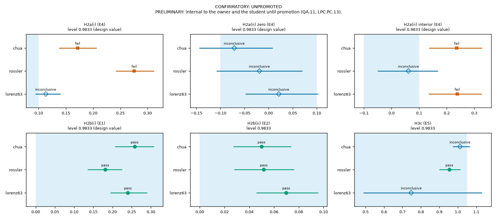
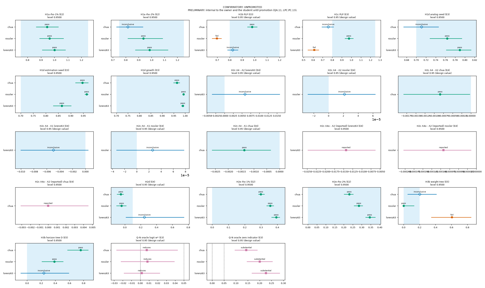
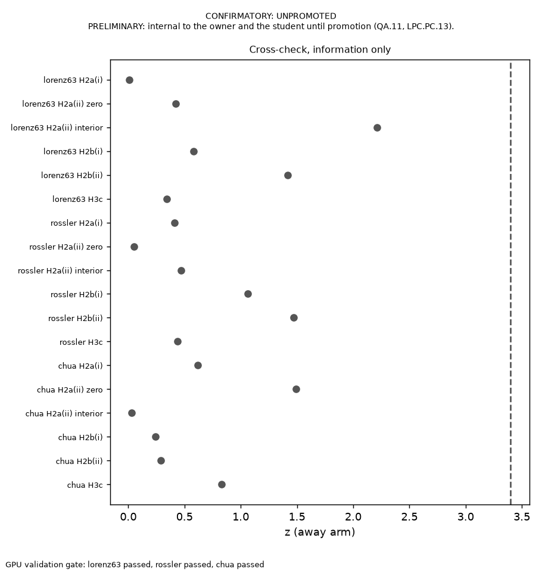

**CONFIRMATORY: UNPROMOTED**
PRELIMINARY: internal to the owner and the student until promotion (QA.11, LPC.PC.13).

Source: the official CPU run of the sealed confirmatory seed. Verdicts are read from the file and not recomputed.

# Preliminary findings for seed CONF-1

This document is built by `tools/findings_build.py` from the files named in §2. Every number in it is either read from one of those files (and listed in the trace file) or is a design constant of the v3 proposal that cites its section. The build computes no statistic and no verdict. Agents write the tables and this frame; the student writes §11. `check` re-renders the whole document and accepts a difference only in §11 and in dated lines appended to §9.

## 1. The question

The study asks whether four measurable local conditions of a chaotic system (recurrence, observability, instability and noise sensitivity) can decide, state by state, how much to trust an analog forecaster against a physics-based forecaster. The analog forecaster (CP) copies the future of the nearest past delay vector. The physics-based forecaster (PLP) estimates the hidden state and integrates the known equations. The two are blended with a weight w on CP. Three pre-registered primary hypotheses (H2a, H2b and H3c) are tested on Lorenz-63, Rössler and Chua's circuit. This document reports what the pre-registered analysis returned and adds no statistic, threshold, subgroup or recomputed verdict.

## 2. What was run

| Item | Value |
|---|---|
| Seed id | CONF-1 |
| Seed kind | confirmatory |
| Label | CONFIRMATORY: UNPROMOTED |
| Preset | full |
| Commit | df8928fd06721d681469c9c3e40705e1b4b8053f |
| Freeze check | equals freeze-1 |
| Backend | cpu |
| LPC_THREADS | 8 |
| Dirty | no |
| Complete | yes |
| Wall seconds | 15555 |
| Start (UTC) | 2026-10-19T08:38:31+00:00 |
| End (UTC) | 2026-10-19T12:57:46+00:00 |
| SHA-256 of results.json | ae4b0fe5bf488f6c147bce6c91a2398e87408f6a5d372ae66d89bdfc90b0cebe |
| SHA-256 of RESULTS.md | 2a4c1d06859d07584b1633c6e7f1b5df205ffe445402509834383fb474649577 |
| Manifest hashes | hashes of the three files given at build and equal to them (the tool cannot read the manifest) |
| Release reference | ledger-seq-20 (format checked only; not verified against the ledger by this tool) |
| Cross-check seed id | CONF-1 |
| Cross-check backend | gpu |
| Cross-check SHA-256 | b768cb036854012301e96f645cb0bb26ab58dbaa1edd19178792d04dc5ac5887 |
| compare_runs text | REF is the official run and NEW the cross-check (by realpath and realpath) |
| Cross-check commit | 78f7f2f2d0431f52a6088a349b2dec8a9a3fba17 (same as official: no) |

Cross-check commits that differ from the official commit: 1 (a later commit is allowed only if `git diff --name-only` shows paths under docs/agent/records/ or the ledger alone; check: git diff --name-only lists 1 path(s), all under docs/agent/records/ or the ledger; both commits are shown above).

## 3. Validation gate (experiment E0) [PRE-REGISTERED]

Checks V1 to V7 of v3 §6, per system. A system whose gate failed is marked PROVISIONAL in every table and figure below. Its verdicts are still computed and shown (v3 §6, E0), and the failure is referred to the owner (DEC-0027, DEC-0031). V3 is reported, not checked.

| System | Check | Statistic | Value | Bar | Pass |
|---|---|---|---|---|---|
| lorenz63 | V1 | delay_jacobian_rel_err | 4.49e-09 | relative error < 10⁻⁴ | yes |
| lorenz63 | V1 | gain_rel_err | 1.99e-09 |  |  |
| lorenz63 | V2 | crlb_ratio_min | 0.838 | ratio in [0.8, 1.2] | yes |
| lorenz63 | V2 | crlb_ratio_max | 0.995 |  |  |
| lorenz63 | V3 | cp_median_vpt_lyapunov | 1.97 | reported, no bar | n/a |
| lorenz63 | V4 | median_half_width at the design M | 0.0366 | median half-width ≤ 0.05 | yes |
| lorenz63 | V5 | km_max_abs_dev | 0.00583 | deviation < 0.01 | yes |
| lorenz63 | V6 | integrator_max_dev_sigma | 4.36e-05 | change < 10⁻³ σ_x | yes |
| lorenz63 | V7 | median_slope | 1.0011 | median slope and median δ/(ρν) at every ρ in [0.9, 1.1] | yes |
| lorenz63 | V7 | efficiency_median rho-0.5% | 0.9992 |  |  |
| lorenz63 | V7 | efficiency_median rho-1% | 1.0003 |  |  |
| lorenz63 | V7 | efficiency_median rho-2% | 1.0030 |  |  |
| lorenz63 | V7 | efficiency_median rho-5% | 1.0107 |  |  |
| lorenz63 | gate | gate_pass | | | yes |
| rossler | V1 | delay_jacobian_rel_err | 1.44e-09 | relative error < 10⁻⁴ | yes |
| rossler | V1 | gain_rel_err | 9.68e-10 |  |  |
| rossler | V2 | crlb_ratio_min | 0.888 | ratio in [0.8, 1.2] | yes |
| rossler | V2 | crlb_ratio_max | 1.097 |  |  |
| rossler | V3 | cp_median_vpt_lyapunov | 3.43 | reported, no bar | n/a |
| rossler | V4 | median_half_width at the design M | 0.0281 | median half-width ≤ 0.05 | yes |
| rossler | V5 | km_max_abs_dev | 0.00583 | deviation < 0.01 | yes |
| rossler | V6 | integrator_max_dev_sigma | 3.65e-05 | change < 10⁻³ σ_x | yes |
| rossler | V7 | median_slope | 1.0000 | median slope and median δ/(ρν) at every ρ in [0.9, 1.1] | yes |
| rossler | V7 | efficiency_median rho-0.5% | 0.9978 |  |  |
| rossler | V7 | efficiency_median rho-1% | 0.9978 |  |  |
| rossler | V7 | efficiency_median rho-2% | 0.9976 |  |  |
| rossler | V7 | efficiency_median rho-5% | 0.9998 |  |  |
| rossler | gate | gate_pass | | | yes |
| chua | V1 | delay_jacobian_rel_err | 2.28e-09 | relative error < 10⁻⁴ | yes |
| chua | V1 | gain_rel_err | 1.44e-09 |  |  |
| chua | V2 | crlb_ratio_min | 0.929 | ratio in [0.8, 1.2] | yes |
| chua | V2 | crlb_ratio_max | 1.011 |  |  |
| chua | V3 | cp_median_vpt_lyapunov | 2.8 | reported, no bar | n/a |
| chua | V4 | median_half_width at the design M | 0.0467 | median half-width ≤ 0.05 | yes |
| chua | V5 | km_max_abs_dev | 0.00583 | deviation < 0.01 | yes |
| chua | V6 | integrator_max_dev_sigma | 0.000584 | change < 10⁻³ σ_x | yes |
| chua | V7 | median_slope | 1.0003 | median slope and median δ/(ρν) at every ρ in [0.9, 1.1] | yes |
| chua | V7 | efficiency_median rho-0.5% | 0.9995 |  |  |
| chua | V7 | efficiency_median rho-1% | 1.0000 |  |  |
| chua | V7 | efficiency_median rho-2% | 1.0015 |  |  |
| chua | V7 | efficiency_median rho-5% | 1.0026 |  |  |
| chua | gate | gate_pass | | | yes |

> Every system passed the validation gate, so no result carries the PROVISIONAL mark.

## 4. Overall verdicts and the decision rule [PRE-REGISTERED]

Decision rule (v3 §7). A hypothesis is supported if it passes on all three systems, not supported if it fails on at least one system, and inconclusive otherwise, including when a system has no result. Requiring every system to pass is an intersection–union test, so the error of "supported" needs no further multiplicity correction. The error of "not supported" is not controlled this way: with 95% intervals it can reach about 7.3% over three systems (about 14% for H2c's two parts).

Each cell below is the stored verdict word. A "supported" verdict is always written "supported (preliminary, unpromoted)". The last column is the clip-sensitivity text copied from RESULTS.md.

| ID | Role | lorenz63 | rossler | chua | Overall | clip |
|---|---|---|---|---|---|---|
| H1a | secondary | pass | pass | inconclusive | inconclusive | lorenz63: n/a; rossler: n/a; chua: n/a |
| H1b | secondary | inconclusive | fail | pass | not supported | lorenz63: —; rossler: —; chua: — |
| H1c | secondary | fail | pass | inconclusive | not supported | lorenz63: invariant; rossler: invariant; chua: invariant |
| H1d | secondary | pass | pass | inconclusive | inconclusive | lorenz63: n/a; rossler: n/a; chua: n/a |
| Q-N | estimate | logit: reduces; indicator: substantial | logit: reduces; indicator: substantial | logit: reduces; indicator: substantial | estimate (read, no pass/fail); the stored per-system words are the logit part only | lorenz63: —; rossler: —; chua: — |
| H2a | primary | fail | fail | fail | not supported | lorenz63: (i) invariant; (ii) —; rossler: (i) invariant; (ii) —; chua: (i) invariant; (ii) — |
| H2b | primary | pass | pass | pass | supported (preliminary, unpromoted) | lorenz63: —; rossler: —; chua: — |
| H2c | secondary | inconclusive | inconclusive | pass | inconclusive | lorenz63: —; rossler: —; chua: — |
| H2d | secondary | inconclusive | pass | pass | inconclusive | lorenz63: —; rossler: —; chua: — |
| H2e | secondary | pass | pass | pass | supported (preliminary, unpromoted) | lorenz63: —; rossler: —; chua: — |
| gain_bound | reported | reported | reported | reported | reported (no pass/fail) | lorenz63: n/a; rossler: n/a; chua: n/a |
| H3a | secondary | inconclusive | inconclusive | inconclusive | inconclusive | lorenz63: invariant; rossler: invariant; chua: invariant |
| H3b | secondary | fail | pass | inconclusive | not supported | lorenz63: —; rossler: —; chua: — |
| H3c | primary | inconclusive | pass | inconclusive | inconclusive | lorenz63: —; rossler: —; chua: — |

Q-N is read by the table of v3 §7, separately for each of its two parts (logit w* on the interior states, and the indicator of w* at zero), and is never pass or fail; the Q-N row shows both stored readings. v3 §2 and §7 read the two parts separately, but the stored overall word `verdicts.Q-N` collapses them to the logit part: its per-system words are lorenz63 reduces, rossler reduces, chua reduces. The hybrid's horizon gain is reported, v1 statistic, v3 screen pending.

Primary hypotheses, stored overall words:
- **H2a**: not supported. Fail on at least one system. The error of "not supported" is not controlled this way (§7), and this is not a statement about systems beyond the three studied. Pre-registered reading of a failure (v3 §7): instability enters the weight through anisotropic seeds, and the size of the departure measures how far real attractors are from the separation assumption. v3 §7 pre-registered this reading and it is not tested here. Parts whose stored word is fail: lorenz63: H2a(ii) interior (fail); rossler: H2a(i) (fail); chua: H2a(i) (fail), H2a(ii) interior (fail). Precision (v3 §7, DEF-0022): H2a's second part can be refuted but essentially cannot pass: that would need a partial correlation within about 0.01 of zero.
- **H2b**: supported (preliminary, unpromoted). Pass on all three systems in this preliminary, unpromoted run. The error of "supported" needs no further multiplicity correction (intersection–union).
- **H3c**: inconclusive. No system failed and at least one could not be decided at this precision. Inconclusive does not say the effect is absent.

Secondary rows (v3 §2; each is read at the level 95% with no multiplicity adjustment, v3 §7):
- **H2c (secondary)**: inconclusive. No system failed and at least one could not be decided at this precision. Inconclusive does not say the effect is absent.
- **H2e (secondary)**: supported (preliminary, unpromoted). Pass on all three systems in this preliminary, unpromoted run. The error of "supported" needs no further multiplicity correction (intersection–union).
- **H3a (secondary)**: inconclusive. No system failed and at least one could not be decided at this precision. Inconclusive does not say the effect is absent.

## 5. The three primary hypotheses (E1, E2, E4, E5) [PRE-REGISTERED]

Each row is one primary part on one system: the stored estimate, its interval at the level stored in the result (or the primary level of v3 §7 where the result stores none), the pass band of v3 §2 and the stored verdict. The two notes on every row are limitations stated before the run (v3 §8). Endpoints are rounded to four-digit precision for printing; every verdict uses the unrounded endpoints (v3 §7), so a printed edge can equal a band edge that the stored endpoint does not reach.

| System | Part | Estimate | Interval | Level | Band | Verdict | Notes |
|---|---|---|---|---|---|---|---|
| lorenz63 | H2a(i) | 0.1129 | [0.09446, 0.1393] | 0.9833 (design value, not stored) | interval below 0.1 (strict) | inconclusive | LM iteration error: not estimated; block-sensitive label: not computable for the sealed run |
| lorenz63 | H2a(ii) zero | 0.02094 | [-0.04719, 0.1015] | 0.9833 (design value, not stored) | interval inside (−0.1, 0.1) (strict) | inconclusive | LM iteration error: not estimated; block-sensitive label: not computable for the sealed run |
| lorenz63 | H2a(ii) interior | 0.2379 | [0.136, 0.3253] | 0.9833 (design value, not stored) | interval inside (−0.1, 0.1) (strict) | fail | LM iteration error: not estimated; block-sensitive label: not computable for the sealed run |
| lorenz63 | H2b(i) | 0.24 | [0.1952, 0.2888] | 0.9833 (design value, not stored) | lower bound > 0 (strict) | pass | LM iteration error: not estimated; block-sensitive label: not computable for the sealed run |
| lorenz63 | H2b(ii) | 0.06982 | [0.04603, 0.09515] | 0.9833 | lower bound > 0 (strict) | pass | LM iteration error: not estimated; block-sensitive label: not computable for the sealed run |
| lorenz63 | H3c | 0.7476 | [0.491, 1.13] | 0.9833 | upper bound ≤ 1.05 (closed) | inconclusive | LM iteration error: not estimated; block-sensitive label: not computable for the sealed run |
| rossler | H2a(i) | 0.2754 | [0.2426, 0.3107] | 0.9833 (design value, not stored) | interval below 0.1 (strict) | fail | LM iteration error: not estimated; block-sensitive label: not computable for the sealed run |
| rossler | H2a(ii) zero | -0.01915 | [-0.1072, 0.06891] | 0.9833 (design value, not stored) | interval inside (−0.1, 0.1) (strict) | inconclusive | LM iteration error: not estimated; block-sensitive label: not computable for the sealed run |
| rossler | H2a(ii) interior | 0.06147 | [-0.04826, 0.1662] | 0.9833 (design value, not stored) | interval inside (−0.1, 0.1) (strict) | inconclusive | LM iteration error: not estimated; block-sensitive label: not computable for the sealed run |
| rossler | H2b(i) | 0.1811 | [0.1363, 0.2238] | 0.9833 (design value, not stored) | lower bound > 0 (strict) | pass | LM iteration error: not estimated; block-sensitive label: not computable for the sealed run |
| rossler | H2b(ii) | 0.05173 | [0.0281, 0.07576] | 0.9833 | lower bound > 0 (strict) | pass | LM iteration error: not estimated; block-sensitive label: not computable for the sealed run |
| rossler | H3c | 0.9544 | [0.9012, 1.012] | 0.9833 | upper bound ≤ 1.05 (closed) | pass | LM iteration error: not estimated; block-sensitive label: not computable for the sealed run |
| chua | H2a(i) | 0.1714 | [0.1382, 0.2054] | 0.9833 (design value, not stored) | interval below 0.1 (strict) | fail | LM iteration error: not estimated; block-sensitive label: not computable for the sealed run |
| chua | H2a(ii) zero | -0.07136 | [-0.1428, 0.007589] | 0.9833 (design value, not stored) | interval inside (−0.1, 0.1) (strict) | inconclusive | LM iteration error: not estimated; block-sensitive label: not computable for the sealed run |
| chua | H2a(ii) interior | 0.2363 | [0.1375, 0.3266] | 0.9833 (design value, not stored) | interval inside (−0.1, 0.1) (strict) | fail | LM iteration error: not estimated; block-sensitive label: not computable for the sealed run |
| chua | H2b(i) | 0.2575 | [0.2074, 0.3064] | 0.9833 (design value, not stored) | lower bound > 0 (strict) | pass | LM iteration error: not estimated; block-sensitive label: not computable for the sealed run |
| chua | H2b(ii) | 0.04987 | [0.02724, 0.07348] | 0.9833 | lower bound > 0 (strict) | pass | LM iteration error: not estimated; block-sensitive label: not computable for the sealed run |
| chua | H3c | 1.012 | [0.9752, 1.062] | 0.9833 | upper bound ≤ 1.05 (closed) | inconclusive | LM iteration error: not estimated; block-sensitive label: not computable for the sealed run |

Level cells that show a design value: 12.

Iterative error of the PLP estimator: not estimated for this run. Development evidence is in docs/study/lm_doubling_dev0_report_v3.md and in the limitation on iterative error (DEF-0027) in §10.

*Figure F1 (experiments E1, E2, E4 and E5; v3 identifiers H2a, H2b and H3c). One panel per primary part, one row per system. Each marker is the stored estimate and each bar its moving-block bootstrap percentile interval (blocks of 5 consecutive test states, 2000 resamples) at level 98.33% (each panel states its level). The shaded region is the pass band of v3 §2. Marker shape and text give the stored verdict: filled circle pass, cross fail, open diamond inconclusive. A system that failed the validation gate is marked PROVISIONAL.*

Cells written "not recorded" so far: 0. Null leaves written "not computed" so far: 0. The full list is in Appendix C.

## 6. Secondary hypotheses, Q-N, H3a counts and the gain bound (E2 to E5) [PRE-REGISTERED]

Endpoints are rounded to four-digit precision for printing; every verdict uses the unrounded endpoints (v3 §7). The H2c row A4o minus A2 is reported with its interval and carries no verdict (v3 §2).

| System | Part | Estimate | Interval | Level | Band | Verdict |
|---|---|---|---|---|---|---|
| lorenz63 | H1a rho-1% | 1.001 | [0.9092, 1.082] | 0.9500 | interval inside [0.75, 1.25] (closed) | pass |
| lorenz63 | H1a rho-2% | 0.9848 | [0.8747, 1.126] | 0.9500 | interval inside [0.75, 1.25] (closed) | pass |
| lorenz63 | H1b PLP | 0.8244 | [0.7822, 0.8652] | 0.95 (design value, not stored) | interval inside [0.8, 1.2] (closed) | inconclusive |
| lorenz63 | H1c PLP | 0.6122 | [0.545, 0.6582] | 0.95 (design value, not stored) | interval inside [0.8, 1.25] (closed) | fail |
| lorenz63 | H1d analog seed | 0.7895 | [0.7617, 0.8126] | 0.9500 | lower bound ≥ 0.7 (closed) | pass |
| lorenz63 | H1d estimation seed | 0.8642 | [0.8301, 0.9009] | 0.9500 | lower bound ≥ 0.7 (closed) | pass |
| lorenz63 | H1d growth | 0.9898 | [0.9837, 0.9942] | 0.9500 | lower bound ≥ 0.7 (closed) | pass |
| lorenz63 | H2c A4 - A2 | 0.005852 | [-0.003522, 0.01575] | 0.95 (design value, not stored) | upper bound < 0 (strict) | inconclusive |
| lorenz63 | H2c A4 - A1 | -0.004963 | [-0.01002, 0.0004221] | 0.95 (design value, not stored) | upper bound < 0 (strict) | inconclusive |
| lorenz63 | H2c A4o - A2 (reported) | -0.01433 | [-0.02479, -0.006322] | 0.9500 | reported with its interval, no verdict (v3 §2 H2c) | reported |
| lorenz63 | H2d | 0.2474 | [0.01448, 0.7442] | 0.95 (design value, not stored) | upper bound ≤ 0.10 (closed) | inconclusive |
| lorenz63 | H2e rho-1% | 0.3933 | [0.3648, 0.4137] | 0.9500 | lower bound > 0 (strict) | pass |
| lorenz63 | H2e rho-2% | 0.3437 | [0.3211, 0.3751] | 0.9500 | lower bound > 0 (strict) | pass |
| lorenz63 | H3b weight tree | 0.606 | [0.3489, 0.8444] | 0.9500 | interval inside [0, 0.2) (closed at 0, open at 0.2) | fail |
| lorenz63 | H3b horizon tree D | 0.2378 | [-0.08951, 0.5894] | 0.9500 | lower bound > 0 (strict) | inconclusive |
| rossler | H1a rho-1% | 0.9642 | [0.8898, 1.066] | 0.9500 | interval inside [0.75, 1.25] (closed) | pass |
| rossler | H1a rho-2% | 0.9366 | [0.8168, 1.085] | 0.9500 | interval inside [0.75, 1.25] (closed) | pass |
| rossler | H1b PLP | 0.6978 | [0.6592, 0.7327] | 0.95 (design value, not stored) | interval inside [0.8, 1.2] (closed) | fail |
| rossler | H1c PLP | 0.9736 | [0.9335, 1.018] | 0.95 (design value, not stored) | interval inside [0.8, 1.25] (closed) | pass |
| rossler | H1d analog seed | 0.7636 | [0.7279, 0.7935] | 0.9500 | lower bound ≥ 0.7 (closed) | pass |
| rossler | H1d estimation seed | 0.9635 | [0.9562, 0.9692] | 0.9500 | lower bound ≥ 0.7 (closed) | pass |
| rossler | H1d growth | 0.9928 | [0.9908, 0.9943] | 0.9500 | lower bound ≥ 0.7 (closed) | pass |
| rossler | H2c A4 - A2 | 2.142e-05 | [-2.8e-05, 6.316e-05] | 0.95 (design value, not stored) | upper bound < 0 (strict) | inconclusive |
| rossler | H2c A4 - A1 | 2.592e-05 | [-3.338e-05, 7.734e-05] | 0.95 (design value, not stored) | upper bound < 0 (strict) | inconclusive |
| rossler | H2c A4o - A2 (reported) | -9.249e-05 | [-0.000204, -1.503e-05] | 0.9500 | reported with its interval, no verdict (v3 §2 H2c) | reported |
| rossler | H2d | -0.04043 | [-0.1052, 0.01674] | 0.95 (design value, not stored) | upper bound ≤ 0.10 (closed) | pass |
| rossler | H2e rho-1% | 0.3564 | [0.3348, 0.377] | 0.9500 | lower bound > 0 (strict) | pass |
| rossler | H2e rho-2% | 0.2838 | [0.2574, 0.3043] | 0.9500 | lower bound > 0 (strict) | pass |
| rossler | H3b weight tree | 0 | [0, 0.1301] | 0.9500 | interval inside [0, 0.2) (closed at 0, open at 0.2) | pass |
| rossler | H3b horizon tree D | 0.3878 | [0.2117, 0.5109] | 0.9500 | lower bound > 0 (strict) | pass |
| chua | H1a rho-1% | 0.9453 | [0.8646, 1.029] | 0.9500 | interval inside [0.75, 1.25] (closed) | pass |
| chua | H1a rho-2% | 0.8167 | [0.7281, 0.9318] | 0.9500 | interval inside [0.75, 1.25] (closed) | inconclusive |
| chua | H1b PLP | 0.9796 | [0.9422, 1.019] | 0.95 (design value, not stored) | interval inside [0.8, 1.2] (closed) | pass |
| chua | H1c PLP | 0.7581 | [0.6913, 0.8127] | 0.95 (design value, not stored) | interval inside [0.8, 1.25] (closed) | inconclusive |
| chua | H1d analog seed | 0.7109 | [0.6739, 0.7458] | 0.9500 | lower bound ≥ 0.7 (closed) | inconclusive |
| chua | H1d estimation seed | 0.9465 | [0.9185, 0.9692] | 0.9500 | lower bound ≥ 0.7 (closed) | pass |
| chua | H1d growth | 0.9639 | [0.9491, 0.9761] | 0.9500 | lower bound ≥ 0.7 (closed) | pass |
| chua | H2c A4 - A2 | -0.0008394 | [-0.001834, -3.19e-05] | 0.95 (design value, not stored) | upper bound < 0 (strict) | pass |
| chua | H2c A4 - A1 | -0.001372 | [-0.002622, -0.000351] | 0.95 (design value, not stored) | upper bound < 0 (strict) | pass |
| chua | H2c A4o - A2 (reported) | -7.562e-06 | [-0.003099, 0.004523] | 0.9500 | reported with its interval, no verdict (v3 §2 H2c) | reported |
| chua | H2d | -0.04999 | [-0.09802, -0.01685] | 0.95 (design value, not stored) | upper bound ≤ 0.10 (closed) | pass |
| chua | H2e rho-1% | 0.2985 | [0.2841, 0.3203] | 0.9500 | lower bound > 0 (strict) | pass |
| chua | H2e rho-2% | 0.2302 | [0.2017, 0.2517] | 0.9500 | lower bound > 0 (strict) | pass |
| chua | H3b weight tree | 0.2036 | [0.05085, 0.4111] | 0.9500 | interval inside [0, 0.2) (closed at 0, open at 0.2) | inconclusive |
| chua | H3b horizon tree D | 0.7592 | [0.5718, 0.865] | 0.9500 | lower bound > 0 (strict) | pass |

Level cells that show a design value: 15.

The band of the H3b weight tree is [0, 0.2): closed at 0 and open at 0.2 (v3 §2). An interval whose lower bound is exactly 0 is therefore inside the band, and the verdict words in the table are the stored ones.

Q-N, oracle values, read by the table of v3 §7 (a reading, never pass or fail):

| System | Part | Estimate | Interval | Level | Band | Verdict |
|---|---|---|---|---|---|---|
| lorenz63 | Q-N oracle logit w* | 0.001802 | [-0.01865, 0.02238] | 0.95 (design value, not stored) | read by the table of v3 §7 (edges 0 and 0.05) | reduces |
| lorenz63 | Q-N oracle zero indicator | 0.2266 | [0.1673, 0.2839] | 0.95 (design value, not stored) | read by the table of v3 §7 (edges 0 and 0.05) | substantial |
| rossler | Q-N oracle logit w* | 0.008222 | [-0.0222, 0.03906] | 0.95 (design value, not stored) | read by the table of v3 §7 (edges 0 and 0.05) | reduces |
| rossler | Q-N oracle zero indicator | 0.2002 | [0.1462, 0.2538] | 0.95 (design value, not stored) | read by the table of v3 §7 (edges 0 and 0.05) | substantial |
| chua | Q-N oracle logit w* | 0.007371 | [-0.02731, 0.0427] | 0.95 (design value, not stored) | read by the table of v3 §7 (edges 0 and 0.05) | reduces |
| chua | Q-N oracle zero indicator | 0.1438 | [0.09589, 0.1902] | 0.95 (design value, not stored) | read by the table of v3 §7 (edges 0 and 0.05) | substantial |

Level cells that show a design value: 6.

H3a: events and censored states per regime, with the stored Holm-adjusted log-rank p-values (DEF-0018). H3a cannot fail, since no equivalence margin is set (v3 §2).

| System | Regime | States | Events | Censored |
|---|---|---|---|---|
| lorenz63 | r0 | 42 | 42 | 0 |
| lorenz63 | r1 | 16 | 16 | 0 |
| lorenz63 | r2 | 220 | 220 | 0 |
| lorenz63 | r3 | 264 | 264 | 0 |
| lorenz63 | r4 | 191 | 191 | 0 |
| lorenz63 | r5 | 267 | 267 | 0 |
| rossler | r0 | 263 | 260 | 3 |
| rossler | r1 | 216 | 216 | 0 |
| rossler | r2 | 344 | 343 | 1 |
| rossler | r3 | 177 | 176 | 1 |
| chua | r0 | 376 | 374 | 2 |
| chua | r1 | 104 | 104 | 0 |
| chua | r2 | 178 | 174 | 4 |
| chua | r3 | 192 | 192 | 0 |
| chua | r4 | 107 | 107 | 0 |
| chua | r5 | 43 | 43 | 0 |

| System | Pair (a, b) | Raw p | Holm p |
|---|---|---|---|
| lorenz63 | 0, 5 | 6.31e-05 | 0.000315 |
| lorenz63 | 5, 3 | 0.231 | 0.693 |
| lorenz63 | 3, 1 | 0.308 | 0.693 |
| lorenz63 | 1, 4 | 0.321 | 0.693 |
| lorenz63 | 4, 2 | 0.019 | 0.0762 |
| rossler | 2, 3 | 0.124 | 0.124 |
| rossler | 3, 1 | 0.0199 | 0.0398 |
| rossler | 1, 0 | 4.52e-06 | 1.36e-05 |
| chua | 5, 4 | 0.263 | 0.263 |
| chua | 4, 1 | 4.12e-05 | 0.000206 |
| chua | 1, 3 | 0.0429 | 0.0859 |
| chua | 3, 2 | 0.0205 | 0.0616 |
| chua | 2, 0 | 0.00124 | 0.00496 |

Cells written "not recorded" so far: 0. Null leaves written "not computed" so far: 0. The full list is in Appendix C.

Hybrid horizon gain against the P1 bound (reported, v1 statistic, v3 screen pending):

| System | fraction_within_bound | n_states | n_total_states | median_gain_lyapunov | max_gain_lyapunov |
|---|---|---|---|---|---|
| lorenz63 | 0.966 | 647 | 1000 | 0 | 3.57 |
| rossler | 0.870 | 655 | 1000 | 0 | 3.53 |
| chua | 0.934 | 637 | 1000 | 0 | 2.3 |

Reported quantities that carry no verdict (v3 §2 lists each as reported; each value is read from its stored leaf, and no verdict depends on it):

| System | Quantity | Value | Interval |
|---|---|---|---|
| lorenz63 | H2a: test states excluded from part (i) (fewer than two leading horizons) | 312 |  |
| lorenz63 | H2a: test states eligible for part (i) | 688 |  |
| lorenz63 | H2a: median range of w*, span of horizons {1, 2} LT | 0.06497 |  |
| lorenz63 | H2a: states in the span {1, 2} LT | 533 |  |
| lorenz63 | H2a: median range of w*, span of horizons {1, 2, 4} LT | 0.4789 |  |
| lorenz63 | H2a: states in the span {1, 2, 4} LT | 155 |  |
| lorenz63 | H2a: complete-case {1, 2, 4} LT range (a sensitivity), median and interval | 0.4789 | [0.3901, 0.5764] |
| lorenz63 | H2a: states in the complete-case set | 155 |  |
| lorenz63 | H2a: test states with w* = 0 | 285 |  |
| lorenz63 | H2a: test states with w* = 1 | 22 |  |
| lorenz63 | H1a: floor f (r.m.s.) at rho 1% | 0.02477 |  |
| lorenz63 | H1a: floor f (r.m.s.) at rho 2% | 0.05213 |  |
| lorenz63 | H1c: CP median ratio and interval (reported; the tested part is PLP) | 0.4947 | [0.4664, 0.5374] |
| lorenz63 | H1d: N-hat Spearman correlation and interval (reported, not tested) | 0.656 | [0.6132, 0.698] |
| lorenz63 | H3b: stability fraction (share of resamples with D > 0) | 0.9105 |  |
| rossler | H2a: test states excluded from part (i) (fewer than two leading horizons) | 72 |  |
| rossler | H2a: test states eligible for part (i) | 928 |  |
| rossler | H2a: median range of w*, span of horizons {1, 2} LT | 0.0818 |  |
| rossler | H2a: states in the span {1, 2} LT | 271 |  |
| rossler | H2a: median range of w*, span of horizons {1, 2, 4} LT | 0.3774 |  |
| rossler | H2a: states in the span {1, 2, 4} LT | 657 |  |
| rossler | H2a: complete-case {1, 2, 4} LT range (a sensitivity), median and interval | 0.3774 | [0.3362, 0.411] |
| rossler | H2a: states in the complete-case set | 657 |  |
| rossler | H2a: test states with w* = 0 | 305 |  |
| rossler | H2a: test states with w* = 1 | 5 |  |
| rossler | H1a: floor f (r.m.s.) at rho 1% | 0.01728 |  |
| rossler | H1a: floor f (r.m.s.) at rho 2% | 0.03353 |  |
| rossler | H1c: CP median ratio and interval (reported; the tested part is PLP) | 1.02 | [0.9892, 1.08] |
| rossler | H1d: N-hat Spearman correlation and interval (reported, not tested) | 0.6078 | [0.554, 0.6538] |
| rossler | H3b: stability fraction (share of resamples with D > 0) | 1 |  |
| chua | H2a: test states excluded from part (i) (fewer than two leading horizons) | 361 |  |
| chua | H2a: test states eligible for part (i) | 639 |  |
| chua | H2a: median range of w*, span of horizons {1, 2} LT | 0.07902 |  |
| chua | H2a: states in the span {1, 2} LT | 390 |  |
| chua | H2a: median range of w*, span of horizons {1, 2, 4} LT | 0.4066 |  |
| chua | H2a: states in the span {1, 2, 4} LT | 249 |  |
| chua | H2a: complete-case {1, 2, 4} LT range (a sensitivity), median and interval | 0.4066 | [0.3442, 0.4928] |
| chua | H2a: states in the complete-case set | 249 |  |
| chua | H2a: test states with w* = 0 | 284 |  |
| chua | H2a: test states with w* = 1 | 16 |  |
| chua | H1a: floor f (r.m.s.) at rho 1% | 0.03957 |  |
| chua | H1a: floor f (r.m.s.) at rho 2% | 0.07437 |  |
| chua | H1c: CP median ratio and interval (reported; the tested part is PLP) | 0.8411 | [0.767, 0.9074] |
| chua | H1d: N-hat Spearman correlation and interval (reported, not tested) | 0.6295 | [0.5753, 0.681] |
| chua | H3b: stability fraction (share of resamples with D > 0) | 1 |  |

The H2c part labelled A4 - A1 is A4 minus the better single forecaster, chosen on the calibration split (v3 §2 H2c). The stored best_single is lorenz63 A1, rossler A1, chua A1; A1 is PLP alone (w = 0).

*Figure F2 (experiments E2 to E5; v3 identifiers H1a to H1d, H2c to H2e, H3b and Q-N). One panel per secondary part, one row per system. Each marker is the stored estimate and each bar its moving-block bootstrap percentile interval (blocks of 5 consecutive test states, 2000 resamples; H3b resamples construction states) at the level stated in each panel (95% unless the result stores another). The shaded region is the pass band of v3 §2. For Q-N no band is shaded: dashed lines mark the reading edges of v3 §7. Each panel states its level, and the three H2c panels are drawn one per system because the scales differ. Marker shape and text give the stored verdict or reading: filled circle pass, cross fail, open diamond inconclusive, square a Q-N reading (both readings, the logit part and the indicator part) or a quantity that is reported with no verdict. A system that failed the validation gate is marked PROVISIONAL.*

Cells written "not recorded" so far: 0. Null leaves written "not computed" so far: 0. The full list is in Appendix C.

## 7. Handling counters (nothing is silent) [DIAGNOSTIC]

The handling counters of the main systems (PRIME.4). Zero counters are printed, never omitted. The counters of the robustness variants are not listed here: they are in `handling.robustness` of results.json. All nonzero result counts are listed in the Handling section of RESULTS.md; the floors, exclusions and screen-outs among them are read from their stored leaves in the table after the counters.

| Counter | Total | lorenz63 | rossler | chua |
|---|---|---|---|---|
| invariant_mean_replacements | 241 | 0 | 241 | 0 |
| nu_replacements | 241 | 0 | 241 | 0 |
| error_clips | 1 | 0 | 0 | 1 |
| error_clips_cp | 0 | 0 | 0 | 0 |
| error_clips_plp | 1 | 0 | 0 | 1 |
| error_clips_nonfinite | 0 | 0 | 0 | 0 |
| error_clips_plp_href | 0 | 0 | 0 | 0 |
| error_clips_nonfinite_href | 0 | 0 | 0 | 0 |
| gain_replacements | 0 | 0 | 0 | 0 |
| gain_floor | 0 | 0 | 0 | 0 |
| zero_variance_corr | 533090 | 260985 | 128240 | 143865 |
| zero_variance_corr_cp | 533090 | 260985 | 128240 | 143865 |
| zero_variance_corr_plp | 0 | 0 | 0 | 0 |
| curvature_floor | 0 | 0 | 0 | 0 |
| decisive_floor | 0 | 0 | 0 | 0 |
| lm_nonfinite_cost | 510 | 19 | 491 | 0 |
| lm_nonfinite_jacobian | 241 | 0 | 241 | 0 |
| local_dim_zero_distance | 0 | 0 | 0 | 0 |
| oracle_gain_floor | 0 | 0 | 0 | 0 |
| oracle_nonfinite | 0 | 0 | 0 | 0 |
| nu_cap_clips | 447 | 137 | 180 | 130 |
| closed_form_floor_a4 | 0 | 0 | 0 | 0 |
| closed_form_floor_a4o | 0 | 0 | 0 | 0 |
| empty_regime_fallback | 0 | 0 | 0 | 0 |
| empty_regime_fallback_chosen | 0 | 0 | 0 | 0 |
| pooled_curvature_floor | 0 | 0 | 0 | 0 |
| regime_target_constant | 0 | 0 | 0 | 0 |

Failed robustness variants: 0. Robustness variants not run (skipped_variants): 0.

| Result count (leaf of each system) | lorenz63 | rossler | chua |
|---|---|---|---|
| H1b/CP/n_floored | 79 | 92 | 114 |
| H2a/n_excluded_states | 312 | 72 | 361 |
| H1c/PLP/n_ineligible_states | 166 | 46 | 142 |
| H1c/CP/n_ineligible_states | 136 | 51 | 149 |
| H2b/noise/n_constant_states | 62 | 76 | 61 |
| gain_bound/n_screened_out/growth_nonpositive | 136 | 46 | 142 |
| gain_bound/n_screened_out/negative_covariance | 252 | 316 | 250 |
| gain_bound/n_screened_out/censored_single_forecaster | 0 | 1 | 2 |

## 8. GPU cross-check (information only) [CROSS-CHECK: information only]

The GPU run of the same seed is a cross-check, never the result (v3 §9 item 3, DEC-0031). The z value uses the interval arm facing away from the other estimate, and a part disagrees if it exceeds the bound 3.4. The numbers in the first table are copied from the compare_runs text. The hw ratio column is the half-width of the cross-check (GPU) interval divided by the half-width of the official (CPU) interval (the column hw1/hw0 of the compare_runs text, whose REF is the official run and NEW the cross-check), so a value above 1 means the GPU interval is wider.

| System | Part | d | z_sym (information) | z_away (governs) | hw ratio | Status |
|---|---|---|---|---|---|---|
| lorenz63 | H2a(i) | 0.0002 | 0.01 | 0.01 | 1.123 | ok |
| lorenz63 | H2a(ii) zero | 0.0181 | 0.41 | 0.42 | 0.998 | ok |
| lorenz63 | H2a(ii) interior | -0.1253 | 2.15 | 2.21 | 1.083 | ok |
| lorenz63 | H2b(i) | -0.0177 | 0.59 | 0.58 | 1.179 | ok |
| lorenz63 | H2b(ii) | 0.0196 | 1.40 | 1.42 | 0.934 | ok |
| lorenz63 | H3c | -0.0653 | 0.38 | 0.34 | 0.828 | ok |
| rossler | H2a(i) | -0.0102 | 0.44 | 0.41 | 1.275 | ok |
| rossler | H2a(ii) zero | -0.0025 | 0.05 | 0.05 | 0.861 | ok |
| rossler | H2a(ii) interior | 0.0271 | 0.48 | 0.47 | 0.785 | ok |
| rossler | H2b(i) | -0.0293 | 1.06 | 1.06 | 1.143 | ok |
| rossler | H2b(ii) | 0.0209 | 1.48 | 1.47 | 1.005 | ok |
| rossler | H3c | 0.0144 | 0.43 | 0.44 | 1.040 | ok |
| chua | H2a(i) | -0.0115 | 0.58 | 0.62 | 1.002 | ok |
| chua | H2a(ii) zero | 0.0644 | 1.46 | 1.49 | 0.992 | ok |
| chua | H2a(ii) interior | 0.0018 | 0.03 | 0.03 | 0.938 | ok |
| chua | H2b(i) | 0.0073 | 0.25 | 0.24 | 1.011 | ok |
| chua | H2b(ii) | -0.0040 | 0.30 | 0.29 | 0.970 | ok |
| chua | H3c | 0.0575 | 0.99 | 0.83 | 3.036 | ok |

Parts computed 18 of 18; sum of z squared (away) 14.82; largest z (away) 2.21; failing parts 0 (bound 3.4).

Stored verdict words that differ between the official (CPU) and the cross-check (GPU) results files, read from the two files as a string comparison of the stored words (nothing is recomputed). Overall rows: 11. Rows per system: 33. The compare_runs text prints a limited number of leaf lines (20 lines against 53 verdict-type leaves counted, which also include boolean flags of the verdict rows); the tables below are read from the results files and list every string verdict word that differs.

| Overall leaf | Official (CPU) | Cross-check (GPU) |
|---|---|---|
| H2a/by_system/lorenz63 | fail | inconclusive |
| H3c/by_system/lorenz63 | inconclusive | pass |
| H1a/by_system/lorenz63 | pass | inconclusive |
| H1c/by_system/chua | inconclusive | fail |
| Q-N/by_system/rossler | reduces | substantial |
| H2c/by_system/chua | pass | inconclusive |
| H2c/by_system/lorenz63 | inconclusive | fail |
| H2c/verdict | inconclusive | not supported |
| H2d/by_system/lorenz63 | inconclusive | fail |
| H2d/verdict | inconclusive | not supported |
| H3b/by_system/rossler | pass | inconclusive |

| System | Leaf | Official (CPU) | Cross-check (GPU) |
|---|---|---|---|
| lorenz63 | H2a/part_ii/interior/verdict | fail | inconclusive |
| lorenz63 | H2a/part_ii_verdict | fail | inconclusive |
| lorenz63 | H2a/verdict | fail | inconclusive |
| lorenz63 | H3c/verdict | inconclusive | pass |
| lorenz63 | H1a/by_noise/0.01/verdict | pass | inconclusive |
| lorenz63 | H1a/by_noise/0.02/verdict | pass | inconclusive |
| lorenz63 | H1a/verdict | pass | inconclusive |
| lorenz63 | H2c/A4_minus_A1/verdict | inconclusive | pass |
| lorenz63 | H2c/A4_minus_A2/verdict | inconclusive | fail |
| lorenz63 | H2c/verdict | inconclusive | fail |
| lorenz63 | H2d/verdict | inconclusive | fail |
| lorenz63 | H3b/D/verdict | inconclusive | pass |
| lorenz63 | Q-N/deployable/logit_w_interior/reading | reduces | undetermined |
| lorenz63 | clip_sensitivity/by_hypothesis/H2a/parts/interior/verdict_2L | fail | inconclusive |
| lorenz63 | clip_sensitivity/by_hypothesis/H2c/parts/A4_minus_A1/verdict_2L | inconclusive | pass |
| lorenz63 | clip_sensitivity/by_hypothesis/H2c/parts/A4_minus_A2/verdict_2L | inconclusive | fail |
| lorenz63 | clip_sensitivity/by_hypothesis/H2d/parts/A4_over_A3/verdict_2L | inconclusive | fail |
| lorenz63 | clip_sensitivity/by_hypothesis/H3c/parts/A5_over_A4/verdict_2L | inconclusive | pass |
| rossler | H2a/part_ii/zero/verdict | inconclusive | pass |
| rossler | H3b/verdict | pass | inconclusive |
| rossler | H3b/weight_lambda/verdict | pass | inconclusive |
| rossler | Q-N/deployable/logit_w_interior/reading | reduces | substantial |
| rossler | Q-N/oracle/logit_w_interior/reading | reduces | substantial |
| rossler | clip_sensitivity/by_hypothesis/H2a/parts/zero/verdict_2L | inconclusive | pass |
| chua | H2a/part_ii/zero/verdict | inconclusive | pass |
| chua | H1c/PLP/verdict | inconclusive | fail |
| chua | H1c/verdict | inconclusive | fail |
| chua | H2c/A4_minus_A1/verdict | pass | inconclusive |
| chua | H2c/A4_minus_A2/verdict | pass | inconclusive |
| chua | H2c/verdict | pass | inconclusive |
| chua | clip_sensitivity/by_hypothesis/H2a/parts/zero/verdict_2L | inconclusive | pass |
| chua | clip_sensitivity/by_hypothesis/H2c/parts/A4_minus_A1/verdict_2L | pass | inconclusive |
| chua | clip_sensitivity/by_hypothesis/H2c/parts/A4_minus_A2/verdict_2L | pass | inconclusive |

H3a regimes per system (the stored chosen_K of each run). When the numbers differ, the regime-indexed H3a leaves of the longer list have no counterpart in the other run; compare_runs lists them with no per-leaf rule.

| System | Regimes, official (CPU) | Regimes, cross-check (GPU) |
|---|---|---|
| lorenz63 | 6 | 4 |
| rossler | 4 | 4 |
| chua | 6 | 6 |

No primary part exceeds the bound: failing parts 0, largest z (away) 2.21, bound 3.4.

Verdict-type leaves that differ between the two runs: 53. The stored verdict words among them are in the tables above; the official words stand.

GPU validation gate, stored gate_pass: lorenz63 yes, rossler yes, chua yes. The GPU validation gate passed on every system.

compare_runs result: PASS (exit 0). What a TD pass does not mean: it does not reproduce verdicts or the gate outcome. All of this is reported only and changes no verdict (DEC-0031).

*Figure F3 (cross-check, information only; v3 §9 item 3, DEC-0031; experiments E1, E2, E4 and E5). For each of the 18 primary parts, the away-arm z value comparing the official CPU run with the GPU run of the same seed, from the compare_runs text (interval procedure: the 98.33% moving-block bootstrap intervals of the two runs). The dashed line is the bound 3.4. A row would name a failed GPU validation gate and a PROVISIONAL official system if there were one; the footer states the GPU gate of each system. This figure changes no verdict.*

## 9. Reproducibility

Regeneration of the official run (WU-0016, v3 §9 item 4): each dated line below is appended after the event it reports.

- 2026-10-20: The owner regenerated the official run on the same commit from a clean worktree (the owner ran both executions, as the owner ruled). The comparison reports that every compared leaf is equal, apart from the run-record and timing leaves it excludes (tier T zero, result pass), so the regeneration agrees bitwise with the official run.
- 2026-10-21: The document was rebuilt after the audit of the same day, from the same stored result files and the same release reference, with the template edited in three places (the regeneration sentence above, a note on the H3b band edge with its band label, and a proposed limitation that awaits an owner ruling). The rebuild ran on the branch that carries the extension code, not on the frozen commit; the builder imports nothing from the study code and reads only the stored result files, so no result number changed.

## 10. Limitations

All items of v3 §8 apply, plus the registered deficiencies and rulings listed here.

- Deployable closed form: the deployable closed form A4 depends almost only on recurrence distance in noise units.
- Exact model: with an exact model, PLP usually wins after one Lyapunov time.
- Deployable features carry little of the information in the exact ones.
- N̂ measures retrieval sensitivity at the observed (noisy) query, not at the true one, so it is reported, not tested.
- The seed × amplifier test (H1b) assumes isotropic seeds and is applied to PLP only.
- Same attractors, fresh seeds: this is not a new set of systems.
- Interval coverage (DEF-0020): The block-5 percentile intervals undercover at these sample sizes: about 0.938 to 0.947 at 95% with independent states and 0.923 to 0.931 at lag-1 autocorrelation 0.3, which adds about 1 to 2 percentage points of false-verdict probability under dependence (v3 §8; DEF-0020). The pre-registered intervals and block length are kept.
- Slow dependence beyond five states cannot be resolved at these sample sizes.
- Small regimes in H3a (DEF-0018): no minimum is set per regime, so counts are reported beside every p-value.
- Iterative error of PLP (DEF-0027): the iterative error of the fixed Levenberg–Marquardt budget of the PLP estimator (15 iterations) is not estimated for this run. On the development seed DEV-0, a study with 15, 30 and 60 iterations showed the iterative change below 10% of the sampling half-width for 5 of the 18 primary parts (class N) and did not show it below 10% for the other 13 (class X, not negligible, 6; class U, not certified, 7). The projection of its size against the half-width to the full preset, by the square root of the ratio of the numbers of states (test states for H2a and H3c, sweep states for H2b), is stated and not applied. This is development evidence, not a result of this run. The report is docs/study/lm_doubling_dev0_report_v3.md.
- Per-seed gate risk (DEF-0026): V4 and V6 can fail on a given seed, and a failure is referred, never repaired.
- lambda_max for Chua has no published reference value at the study's parameters.
- Doubled thinning is not checked (Methods v2 §M16).
- Bitwise agreement at the official size is extrapolated from smoke size (DEC-0033 M2).
- The gain-bound screen is reported only, computed with the v1 statistic, and the v3 screen is pending (DEC-0033 M3).
- One realization per system: one sealed seed gives one set of data per system, so no replicate variation is estimated.
- The block-sensitive label (a primary verdict that widening the half-width would change) is not computable for the sealed run, because the sealed run writes no states dump (owner default D6).
- Q-N and the gain bound are reported and carry no verdict.
- PROPOSED for owner review, not ruled (DEF-0022): the second part of H2a (the partial-correlation margin test) has low power at these sample sizes: it can be refuted but essentially cannot pass, which v3 §7 anticipated. The margin that v3 §7 projects for it is not reproduced part by part at the full sample size (DEF-0022 status line; the full-size report of WU-0003). In this run the stored interval of the Rossler interior part is wider than the margin band of v3 §2, so that part could not pass at any estimate. The verdict words of its parts are in section 5; an inconclusive word there means the interval was too wide to decide. The pre-registered rule is kept.

## 11. What it means and does not mean [STUDENT]

The student writes this section in their own words. Prompts only, with no results: What did each primary hypothesis claim? Which verdicts are supported, not supported or inconclusive, and what does each word allow you to say? Which limitations matter most for what you say? What would you check next?

## A. Development context [DEVELOPMENT]

No development appendix in this build. Development-seed numbers appear only here, labeled, and never beside the official result (owner ruling D4). A development ensemble may be appended later.

## B. Interval labels

Copied verbatim from the `RESULTS.md` of the official run, one per row (procedure, level, dependence and multiplicity; NVVUQ.16).

- H1a (secondary) — procedure: moving-block bootstrap percentile interval, blocks of 5 consecutive test states in time order, B = 2000; level: 95%; dependence: resampled in blocks of 5 consecutive test states in time order (Künsch 1989), so dependence is kept within a block and none is assumed beyond it; multiplicity: none (secondary, unadjusted), intersection–union across systems, every part of the criterion must pass
- H1b (secondary) — procedure: moving-block bootstrap percentile interval, blocks of 5 consecutive test states in time order, B = 2000; level: 95%; dependence: resampled in blocks of 5 consecutive test states in time order (Künsch 1989), so dependence is kept within a block and none is assumed beyond it; multiplicity: none (secondary, unadjusted), intersection–union across systems, every part of the criterion must pass
- H1c (secondary) — procedure: moving-block bootstrap percentile interval, blocks of 5 consecutive test states in time order, B = 2000; level: 95%; dependence: resampled in blocks of 5 consecutive test states in time order (Künsch 1989), so dependence is kept within a block and none is assumed beyond it; multiplicity: none (secondary, unadjusted), intersection–union across systems, every part of the criterion must pass
- H1d (secondary) — procedure: moving-block bootstrap percentile interval, blocks of 5 consecutive test states in time order, B = 2000; level: 95%; dependence: resampled in blocks of 5 consecutive test states in time order (Künsch 1989), so dependence is kept within a block and none is assumed beyond it; multiplicity: none (secondary, unadjusted), intersection–union across systems, every part of the criterion must pass
- Q-N (estimate) — procedure: moving-block bootstrap percentile interval, blocks of 5 consecutive test states in time order, B = 2000; level: 95%; dependence: resampled in blocks of 5 consecutive test states in time order (Künsch 1989), so dependence is kept within a block and none is assumed beyond it; multiplicity: none (an estimate, read by the table of v3 section 7, not decided)
- H2a (primary) — procedure: moving-block bootstrap percentile interval, blocks of 5 consecutive test states (all of them, not only the eligible ones) in time order, B = 2000, with the eligibility of part (i) and the domain of part (ii) re-evaluated inside each resample (DEC-0008 A4); level: 1 − 0.05/3 (98.33%); dependence: resampled in blocks of 5 consecutive test states in time order (Künsch 1989), so dependence is kept within a block and none is assumed beyond it; multiplicity: Bonferroni over the three primaries (H2a, H2b, H3c), intersection–union across systems, every part of the criterion must pass; iterative error: the fixed 15-iteration Levenberg–Marquardt error of the PLP estimator is not estimated and is unverified (DEC-0024)
- H2b (primary) — procedure: moving-block bootstrap percentile interval, blocks of 5 consecutive test states in time order, B = 2000; level: 1 − 0.05/3 (98.33%); dependence: resampled in blocks of 5 consecutive test states in time order (Künsch 1989), so dependence is kept within a block and none is assumed beyond it; multiplicity: Bonferroni over the three primaries (H2a, H2b, H3c), intersection–union across systems, every part of the criterion must pass; iterative error: the fixed 15-iteration Levenberg–Marquardt error of the PLP estimator is not estimated and is unverified (DEC-0024)
- H2c (secondary) — procedure: moving-block bootstrap percentile interval, blocks of 5 consecutive test states in time order, B = 2000; level: 95%; dependence: resampled in blocks of 5 consecutive test states in time order (Künsch 1989), so dependence is kept within a block and none is assumed beyond it; multiplicity: none (secondary, unadjusted), intersection–union across systems, every part of the criterion must pass
- H2d (secondary) — procedure: moving-block bootstrap percentile interval, blocks of 5 consecutive test states in time order, B = 2000; level: 95%; dependence: resampled in blocks of 5 consecutive test states in time order (Künsch 1989), so dependence is kept within a block and none is assumed beyond it; multiplicity: none (secondary, unadjusted), intersection–union across systems, every part of the criterion must pass
- H2e (secondary) — procedure: moving-block bootstrap percentile interval, blocks of 5 consecutive test states in time order, B = 2000; level: 95%; dependence: resampled in blocks of 5 consecutive test states in time order (Künsch 1989), so dependence is kept within a block and none is assumed beyond it; multiplicity: none (secondary, unadjusted), intersection–union across systems, every part of the criterion must pass
- (reported) — procedure: none, a fraction of states within the P1 bound is reported with no interval; level: not applicable; dependence: not applicable; multiplicity: none (reported with no pass/fail bar)
- H3a (secondary) — procedure: Holm-adjusted log-rank tests between consecutive regimes, p-values with no interval; level: each adjusted p must be below 0.01; dependence: the log-rank test treats states as independent, serial dependence between neighboring states is not modeled; multiplicity: Holm over the consecutive comparisons within a system, intersection–union across systems
- H3b (secondary) — procedure: moving-block bootstrap percentile interval over construction states, blocks of 5 consecutive states in time order, B = 2000; level: 95%; dependence: resampled in blocks of 5 consecutive construction states in time order (Künsch 1989), so dependence is kept within a block and none is assumed beyond it; multiplicity: none (secondary, unadjusted), intersection–union across systems, every part of the criterion must pass; coverage not measured: the interval conditions on the fitted proxies and is not guaranteed to cover, because the split variable can switch between resamples (the bootstrap of a non-smooth functional; the WU-0006 coverage study has no H3b case)
- H3c (primary) — procedure: moving-block bootstrap percentile interval, blocks of 5 consecutive test states in time order, B = 2000; level: 1 − 0.05/3 (98.33%); dependence: resampled in blocks of 5 consecutive test states in time order (Künsch 1989), so dependence is kept within a block and none is assumed beyond it; multiplicity: Bonferroni over the three primaries (H2a, H2b, H3c), intersection–union across systems, every part of the criterion must pass; iterative error: the fixed 15-iteration Levenberg–Marquardt error of the PLP estimator is not estimated and is unverified (DEC-0024)

## C. Trace

Every number quoted above is listed with its source and leaf path in `2026-10-20-prelim-findings-conf1.trace.csv`. Run the `check` command of `tools/findings_build.py` on this directory to verify the document against the sources.

Leaves not found in the sources, written "not recorded": 0. Null leaves written "not computed": 0.
